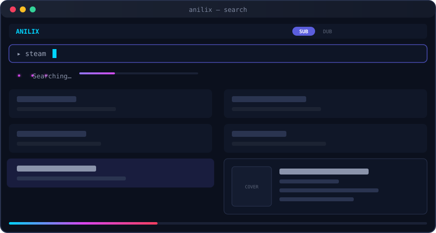

# ✨ Anilix — Stream Anime From Your Terminal

<p align="center">
  
</p>

<!-- Animated glow effect -->
<p align="center">
  
</p>

<h1 align="center">
  
  
  
</h1>

<p align="center">
  <b>A <span style="background: linear-gradient(90deg, #9d4edd, #d946ef, #f43f5e); -webkit-background-clip: text; -webkit-text-fill-color: transparent;"> Material Design 3 </span> terminal anime streaming client, written in Go.</b><br/>
  Search anime, browse episodes, and stream — without ever leaving your terminal.<br/>
  Runs on Linux, macOS, Windows, and yes, <b>your Android phone via Termux</b>.
</p>

<p align="center">
  <a href="https://github.com/hishantik/anilix/releases/latest"></a>
  <a href="https://github.com/hishantik/anilix/stargazers"></a>
  <a href="https://github.com/hishantik/anilix/actions/workflows/ci.yml"></a>
  <a href="./LICENSE"></a>
  
  <a href="https://goreportcard.com/report/github.com/hishantik/anilix"></a>
</p>

<p align="center">
  <a href="#-features">Features</a> &bull;
  <a href="#-what-it-does">What it does</a> &bull;
  <a href="#-demo">Demo</a> &bull;
  <a href="#-supported-platforms">Platforms</a> &bull;
  <a href="#-installation">Installation</a> &bull;
  <a href="#-keybindings">Keybindings</a> &bull;
  <a href="#-configuration">Configuration</a> &bull;
  <a href="#-tech-stack">Tech Stack</a>
</p>

---

## 🎬 What does Anilix do?

> **Think of Anilix as _a browser built for one thing: anime_.** Type a title, and within about a second you get a searchable result grid — each entry enriched with real metadata (synopsis, genres, status, scores) resolved in the background from **AniList, Jikan and Kitsu**. Pick a show, pick an episode, and Anilix extracts a direct stream from a third-party source and hands it to your favourite player — **mpv, VLC or IINA**.

<table align="center">
  <tr>
    <td align="center" width="25%">🔍<br/><b>Search in ~1s</b><br/><sub>Results appear instantly; metadata resolves in the background without ever blocking the list.</sub></td>
    <td align="center" width="25%">📺<br/><b>Stream in ~2s</b><br/><sub>Episode list → servers → embed → master playlist, then straight into your player.</sub></td>
    <td align="center" width="25%">⏭️<br/><b>AniSkip built in</b><br/><sub>Intros and outros are skipped automatically via mpv Lua scripting.</sub></td>
    <td align="center" width="25%">📱<br/><b>Android native</b><br/><sub>A built-in local proxy bridges PRoot/Termux so streams play on your phone.</sub></td>
  </tr>
</table>

<p align="center">
  It also <b>tracks your watching</b>: AniList OAuth syncs your progress with one click, watch history remembers where you left off, and your last 10 searches are kept for instant re-runs.
</p>

<!-- Animated divider -->
<p align="center">
  
</p>

---

## ✨ Demo

<p align="center">
  
</p>

<p align="center">
  <i>Real screen recording — click to watch:</i><br/>
  <a href="https://gist.github.com/user-attachments/assets/c9fdce3f-dd7c-4a06-a6a1-821ac9bdcf2f.mp4"><b>▶ Anilix-Demo.mp4</b></a>
</p>

<p align="center">
  
</p>

---

## 🚀 Features

<div align="center">

| | |
|:---|:---|
| 🎨 **Interactive TUI** — Two-column search layout with instant metadata preview, detail view and episode browser, built on Bubble Tea v2 | 🔍 **Smart Search** — Fast anime search with automatic metadata fetching and multi-source fallback |
| 📦 **Batch Metadata** — All search-result metadata lands in a single API call, so `j`/`k` navigation never waits on the network | 🎚️ **Quality Selection** — Cycle presets: best → 1080p → 720p → 480p → 360p → auto |
| 🌐 **Sub/Dub Toggle** — Switch between subtitled and dubbed versions with `Ctrl+T` | ⏭️ **Auto-Skip** — Intros and outros are skipped automatically with mpv Lua scripts |
| 🕘 **Recent Searches** — Your last 10 searches persist for one-keystroke re-runs | 🔀 **Multi-host Extraction** — Direct streams from multiple hosts with automatic fallback |
| 📱 **Android Proxy** — A local HTTP proxy bridges Android apps and PRoot/Termux for seamless mobile playback | 💾 **Persistent Caching** — Provider responses are cached in-process so repeated views are instant |
| 📊 **AniList Tracking** — OAuth2 login syncs watch progress and status, managed entirely from the TUI | 🖼️ **Cover Art** — Anime covers render right in your terminal: Kitty graphics, half-block Unicode, or chafa |
| 🔄 **Self-Update** — Check for and install updates from inside the app (`Ctrl+S` → Update) | 🧭 **Navigation Drawer** — Search, history, watchlist and settings behind a Material 3 shell |

</div>

<p align="center">
  
</p>

---

## 🖥️ Supported Platforms

<div align="center">

| Platform | Architectures | Supported Players | Install Command |
|:---|:---|:---|:---|
| 🐧 **Linux** | amd64, arm64 | mpv, vlc | See [Linux](#-linux) below |
| 🍎 **macOS** | amd64, arm64 (Apple Silicon) | mpv, vlc, iina | See [macOS](#-macos) below |
| 🪟 **Windows** | amd64 | mpv, vlc | See [Windows](#-windows) below |
| 🤖 **Android (Termux)** | arm64 | mpv-android, vlc-android | See [Termux](#-android-termux) below |

</div>

<p align="center">
  
</p>

---

## 📦 Installation

<!-- ══════════════════════════════════════════════════════════════════════════════ -->
### ⚡ Quick Install (One-Line)

<p align="center"><b>🐧 Linux / 🍎 macOS / 🤖 Termux</b></p>

```bash
curl -fsSL https://raw.githubusercontent.com/hishantik/anilix/main/install.sh | sh
```

<p align="center"><b>🪟 Windows</b></p>

```powershell
Invoke-WebRequest -Uri "https://raw.githubusercontent.com/hishantik/anilix/main/install.bat" -OutFile "install.bat"; .\install.bat
```

<p align="center">
  
</p>

<!-- ══════════════════════════════════════════════════════════════════════════════ -->
<h2 align="center" id="installation-linux">🐧 Linux</h2>

**Install the player first** (pick one):

| Distro | Command |
|:---|:---|
| **Debian / Ubuntu / Mint** | `sudo apt install mpv` |
| **Fedora / RHEL / AlmaLinux / Rocky** | `sudo dnf install mpv` |
| **Arch / CachyOS / EndeavourOS / Manjaro** | `sudo pacman -S mpv` |
| **Alpine Linux** | `sudo apk add mpv` |
| **openSUSE** | `sudo zypper install mpv` |
| **NixOS** | Add `mpv` to `environment.systemPackages` |
| **Void Linux** | `sudo xbps-install mpv` |
| **Gentoo** | `sudo emerge --ask media-video/mpv` |
| **Solus** | `sudo eopkg install mpv` |

**Then install Anilix:**

```bash
# Option 1: One-line install (recommended)
curl -fsSL https://raw.githubusercontent.com/hishantik/anilix/main/install.sh | sh

# Option 2: Download from releases
sudo wget -O /usr/local/bin/anilix https://github.com/hishantik/anilix/releases/latest/download/anilix_linux_amd64
sudo chmod +x /usr/local/bin/anilix

# Option 3: Build from source
git clone https://github.com/hishantik/anilix.git && cd anilix && go build -o anilix .
```

<p align="center">
  
</p>

<!-- ══════════════════════════════════════════════════════════════════════════════ -->
<h2 align="center" id="installation-macos">🍎 macOS</h2>

**1. Install a player:**

```bash
# Option A: mpv (recommended)
brew install mpv

# Option B: IINA
brew install --cask iina

# Option C: VLC
brew install --cask vlc
```

**2. Install Anilix:**

```bash
# Option 1: One-line install (recommended)
curl -fsSL https://raw.githubusercontent.com/hishantik/anilix/main/install.sh | sh

# Option 2: Download from releases (Apple Silicon)
wget https://github.com/hishantik/anilix/releases/latest/download/anilix_darwin_arm64
chmod +x anilix_darwin_arm64
mv anilix_darwin_arm64 /usr/local/bin/anilix

# Option 3: Download from releases (Intel)
wget https://github.com/hishantik/anilix/releases/latest/download/anilix_darwin_amd64
chmod +x anilix_darwin_amd64
mv anilix_darwin_amd64 /usr/local/bin/anilix

# Option 4: Build from source
git clone https://github.com/hishantik/anilix.git && cd anilix && go build -o anilix .
```

<p align="center">
  
</p>

<!-- ══════════════════════════════════════════════════════════════════════════════ -->
<h2 align="center" id="installation-windows">🪟 Windows</h2>

**1. Install a player:**

```powershell
# Option A: mpv (recommended) - via winget
winget install mpv

# Option B: VLC - via winget
winget install VideoLAN.VLC
```

**2. Install Anilix:**

```powershell
# Option 1: PowerShell installer (recommended)
Invoke-WebRequest -Uri "https://raw.githubusercontent.com/hishantik/anilix/main/install.bat" -OutFile "install.bat"; .\install.bat

# Option 2: Download from releases manually
# Download from: https://github.com/hishantik/anilix/releases/latest
# Extract to a folder and add to PATH, or use:

# Option 3: Via scoop (if you have it)
scoop bucket add extras
scoop install anilix

# Option 4: Build from source
git clone https://github.com/hishantik/anilix.git && cd anilix && go build -o anilix.exe .
```

<p align="center">
  
</p>

<!-- ══════════════════════════════════════════════════════════════════════════════ -->
<h2 align="center" id="installation-termux">🤖 Android (Termux)</h2>

> **⚠️ Important:** Install Termux from **[F-Droid](https://f-droid.org/en/packages/com.termux/)** — the Play Store version is abandoned and won't work!

**1. Install a player:**

```bash
pkg update && pkg upgrade
pkg install mpv
```

**2. Install Anilix:**

```bash
# Option 1: One-line install (recommended)
curl -fsSL https://raw.githubusercontent.com/hishantik/anilix/main/install.sh | sh

# Option 2: Download from releases
wget https://github.com/hishantik/anilix/releases/latest/download/anilix_termux_arm64.tar.gz
tar -xzf anilix_termux_arm64.tar.gz
mv anilix ~/../usr/bin/anilix

# Option 3: Build from source (avoid filesystem locks in PRoot!)
mkdir -p /tmp/anilix-build && cp -r . /tmp/anilix-build/ && cd /tmp/anilix-build && go build -o ~/../usr/bin/anilix .
```

**3. Launch:**

```bash
anilix
```

> **📱 Android Proxy:** Anilix ships a dedicated `termux/arm64` release and bridges playback through its built-in local proxy, so mpv-android plays streams from inside PRoot without DNS workarounds.

<p align="center">
  
</p>

<!-- ══════════════════════════════════════════════════════════════════════════════ -->
<h2 align="center">🐹 Go Install</h2>

```bash
go install github.com/hishantik/anilix@latest
```

> **Note:** Go install puts the binary in `$GOPATH/bin` or `$HOME/go/bin`. Make sure that's in your PATH.

<p align="center">
  
</p>

<!-- ══════════════════════════════════════════════════════════════════════════════ -->
<h2 align="center">🔨 Build from Source</h2>

```bash
git clone https://github.com/hishantik/anilix.git && cd anilix
go build -o anilix .
```

**⚠️ PRoot/Termux users:** Build from `/tmp` to avoid filesystem locking errors:

```bash
mkdir -p /tmp/anilix-build && cp -r . /tmp/anilix-build/ && cd /tmp/anilix-build && go build -o ~/anilix .
```

<p align="center">
  
</p>

<!-- ══════════════════════════════════════════════════════════════════════════════ -->
<h2 align="center">📥 Manual Download</h2>

<p align="center">
  Grab the binary for your platform from<br/>
  <a href="https://github.com/hishantik/anilix/releases/latest"><b>👉 GitHub Releases</b></a>
</p>

| Build | Architectures | Notes |
|:---|:---|:---|
| `linux` | amd64, arm64 | Desktop Linux |
| `darwin` | amd64, arm64 | macOS (Intel & Apple Silicon) |
| `windows` | amd64 | Windows 10/11 |
| `termux` | arm64 | Android via Termux (separate build) |

<p align="center">
  
</p>

---

## ⌨️ Keybindings

| Key | Action |
|:---|:---|
| `j` / `k` / `↑` / `↓` | Navigate lists |
| `Enter` | Search / Select / Confirm |
| `Esc` | Back / Cancel |
| `/` | Focus search bar |
| `Ctrl+T` | Toggle sub/dub |
| `Ctrl+S` | Open settings popup |
| `Ctrl+G` | Open the design system showcase |
| `Ctrl+C` | Quit |

<p align="center">
  
</p>

---

## 🧭 Usage

**Launch the interactive TUI:**

```bash
anilix
```

**Other commands:**

```bash
anilix version          # Show version
anilix sources          # List available sources
anilix anilist login    # Login to AniList via browser
anilix anilist logout   # Logout from AniList
anilix anilist status   # Check AniList connection status
```

**Update Anilix:**

```bash
# From inside the app: Ctrl+S → Update
# Or from shell:
sh install.sh --update
```

<p align="center">
  
</p>

---

## ⚙️ Configuration

<p align="center">
  Config file: <code>~/.anilix/anilix.toml</code><br/>
  Or change settings at runtime via <code>Ctrl+S</code> popup menu.
</p>

| Setting | Default | Description |
|:---|:---|:---|
| `player` | `mpv` | Media player used for playback (`mpv`, `vlc`, `iina`) |
| `quality` | `auto` | Stream quality: `best`, `1080p`, `720p`, `480p`, `360p`, `auto` |
| `source` | _(empty)_ | Preferred stream source |
| `history.enabled` | `true` | Enable watch history |
| `aniskip.enabled` | `true` | Auto-skip intros/outros (requires mpv) |
| `anilist.token` | _(empty)_ | AniList OAuth token (use `anilix anilist login`) |
| `artwork.renderer` | `auto` | Cover art: `auto`, `kitty`, `iterm2`, `halfblock`, `chafa`, `ascii`, `none` |

**Environment variables:**

| Variable | Example | Description |
|:---|:---|:---|
| `ANILIX_PLAYER` | `vlc` | Override default player |
| `ANILIX_QUALITY` | `1080p` | Override default quality |

<p align="center">
  
</p>

---

## 🧰 Tech Stack

| Technology | Purpose |
|:---|:---|
| **Go** | Core language |
| **Cobra** | CLI structure and commands |
| **Bubble Tea v2** | Terminal UI framework (`charm.land/bubbletea/v2`) |
| **Lip Gloss** | Style system for Bubble Tea |
| **Viper** | Configuration management |
| **GoReleaser** | Cross-platform release builds |
| **mpv Lua** | Intro/outro skip (AniSkip) |
| **SMIL SVG** | Animations (no GIFs!) |

---

## ⚖️ License & Disclaimer

<p align="center">
  Licensed under the <a href="./LICENSE">MIT License</a>.<br/>
  Anilix is a neutral interface — it hosts, stores and redistributes no media.<br/>
  See the <a href="./DISCLAIMER.md">disclaimer</a> for details.
</p>

<p align="center">
  Inspired by <a href="https://github.com/pystardust/ani-cli">ani-cli</a>.
</p>

<p align="center">
  
</p>

<p align="center"><i>Made with 💜, Go and a terminal.</i></p>
